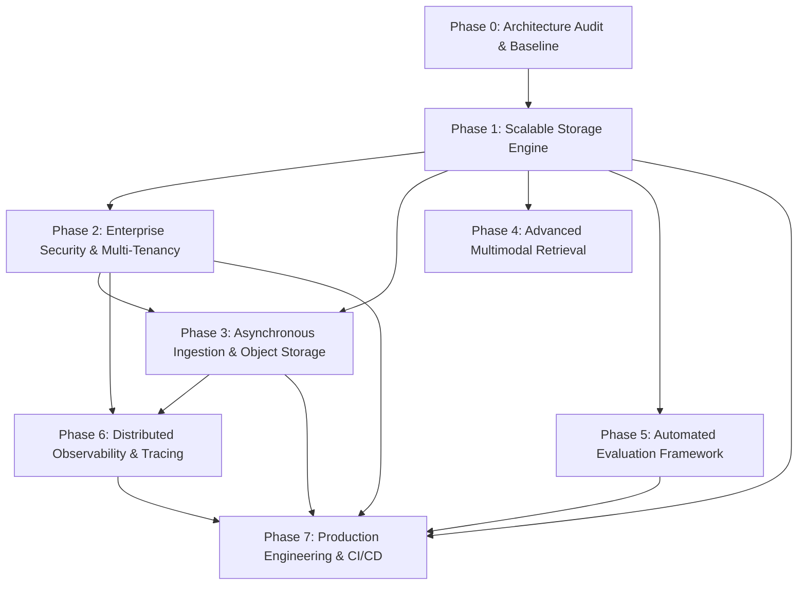

# Enterprise RAG Implementation Roadmap

**Platform Target:** Enterprise-Grade Multi-Modal Knowledge Intelligence Platform  
**Architecture Methodology:** Incremental Evolution (Zero-Downtime Migration, Preservation of Working Features)  

---

## 1. Roadmap Overview & Dependency Graph

---

## 2. Phase-by-Phase Implementation Specifications

### Phase 1: Scalable Storage (Primary Foundation)
* **Goal**: Replace the in-memory/pickled FAISS + `metadata.pkl` stack with a scalable, persistent, concurrency-safe storage architecture (**PostgreSQL + Qdrant + S3/MinIO Object Storage**), while strictly preserving a backward-compatible fallback to local FAISS.
* **Key Tasks**:
  1. **Docker Compose Local Development Stack**:
     - Create `docker-compose.dev.yml` defining services:
       - `postgres`: PostgreSQL 16 with health checks and volume persistence.
       - `qdrant`: Qdrant vector database (`qdrant/qdrant:latest`) exposing ports 6333 (HTTP) and 6334 (gRPC).
       - `redis`: Redis 7 alpine for cache and task brokers.
       - `minio`: MinIO S3-compatible object store with web console.
  2. **Relational Schema & Database Migrations (Alembic + SQLAlchemy)**:
     - Configure Alembic for version-controlled, reversible database migrations.
     - Implement normalized SQLAlchemy models:
       - `Tenant`: `id` (UUID), `name`, `created_at`.
       - `User`: `id` (UUID), `tenant_id` (FK), `email`, `role`, `created_at`.
       - `Document`: `id` (UUID), `tenant_id` (FK), `filename`, `file_type`, `s3_key`, `page_count`, `checksum_sha256`, `status`, `created_at`.
       - `DocumentChunk`: `id` (UUID), `document_id` (FK), `tenant_id` (FK), `chunk_index`, `page_number`, `chunk_type` (text/table/image), `content_text`, `summary_text`, `image_s3_key`, `created_at`.
       - `IngestionJob`: `id` (UUID), `tenant_id` (FK), `status`, `error_message`, `progress_percent`.
  3. **Qdrant Vector Store Implementation**:
     - Implement `QdrantVectorStore` conforming to `BaseVectorStore`.
     - Create collection `rag_enterprise_chunks` with 384-dimension Cosine distance and HNSW index.
     - Configure **Payload Indexes**:
       - `tenant_id` (keyword index, essential for fast pre-filtering).
       - `document_id` (keyword index, essential for single-document cascade deletions).
       - `chunk_type` (keyword index: text, table, image).
  4. **Stable Deterministic UUID Strategy**:
     - Document UUID: Deterministically hashed from `SHA-256(tenant_id + filename + file_content_hash)`.
     - Chunk UUID: Deterministically hashed from `UUIDv5(document_uuid, chunk_index)`.
     - Completely eliminates index desynchronization and array shifting.
  5. **Document-Level CRUD & Cascading Mutations**:
     - `upsert_document(document_id, chunks)`: Atomic database transaction updating Postgres metadata and upserting points in Qdrant with payload.
     - `delete_document(document_id)`: Atomic cascade deleting relational records and deleting all points from Qdrant matching `Filter(must=[FieldCondition(key="document_id", match=MatchValue(value=document_id))])`.
  6. **Zero-Downtime Data Migration & Rollback Strategy**:
     - Script `scripts/migrate_faiss_to_qdrant.py`:
       - Loads `faiss_store/faiss.index`, `metadata.pkl`, and `bm25.pkl`.
       - Extracts existing vectors and metadata.
       - Assigns default tenant and document UUIDs.
       - Upserts into PostgreSQL and Qdrant in batches.
       - Validates retrieval parity (top-5 query parity check).
     - **Rollback Procedure**: If Qdrant is unreachable or environment specifies `VECTOR_STORE_TYPE=faiss`, the system automatically falls back to `FaissVectorStore` without interrupting API service.
* **Acceptance Criteria**:
  - `docker compose -f docker-compose.dev.yml up -d` boots PostgreSQL, Qdrant, Redis, and MinIO with passing health checks.
  - Adding, updating, or deleting a document operates at the single-document level without re-indexing the whole corpus.
  - Database schema is version-controlled via Alembic migrations.
  - Integration tests in `tests/test_storage.py` pass with 100% success against both Qdrant and the FAISS fallback.

---

### Phase 2: Enterprise Security & Multi-Tenancy
* **Goal**: Enforce strict data isolation, authentication, authorization, and rate limiting across all APIs.
* **Key Tasks**:
  1. Implement JWT-based authentication with bcrypt password hashing and token refresh endpoints.
  2. Model Role-Based Access Control (RBAC): `SYSTEM_ADMIN`, `ORG_ADMIN`, `MEMBER`, `VIEWER`.
  3. Enforce **Strict Multi-Tenant Retrieval**:
     - Extract `tenant_id` exclusively from the authenticated JWT token (never from query parameters or user-provided body fields).
     - Inject `tenant_id` into PostgreSQL queries and Qdrant vector payload filters:
       `Filter(must=[FieldCondition(key="tenant_id", match=MatchValue(value=current_user.tenant_id))])`.
  4. Add API rate limiting via Token Bucket / Sliding Window (SlowAPI or Redis-backed).
  5. Implement strict file upload validation: MIME-type verification, magic number inspection, filename sanitization, size limits.
  6. Add audit logging for sensitive actions (user logins, document uploads, document deletions, cross-tenant access attempts).
* **Acceptance Criteria**:
  - User from Organization A receives 0 results when querying documents owned by Organization B, even if document IDs or metadata filters match.
  - Automated security tests verify cross-tenant denial and unauthenticated access blocking.

---

### Phase 3: Asynchronous Ingestion & Object Storage
* **Goal**: Decouple heavy multimodal document parsing and embedding computation from the API request lifecycle.
* **Key Tasks**:
  1. Integrate distributed task queue: **Redis + Celery** (or ARQ).
  2. Implement an S3-compatible Object Storage abstraction (`StorageService` supporting MinIO and local filesystem fallback).
  3. Define asynchronous worker tasks:
     - `process_document_task(job_id, file_path, tenant_id)`
     - `extract_tables_task()`
     - `extract_images_task()`
     - `embed_and_index_task()`
  4. Implement idempotent job tracking: Track `IngestionJob` status (`PENDING`, `EXTRACTING`, `EMBEDDING`, `COMPLETED`, `FAILED`, `RETRYING`).
  5. Add exponential backoff, retry policies, and dead-letter queue for corrupted files.
* **Acceptance Criteria**:
  - `/api/upload` returns an immediate `202 Accepted` with a `job_id` within 50ms.
  - Multiple 50-page PDFs can be ingested concurrently without causing HTTP timeouts or API degradation.
  - Job status endpoint (`/api/jobs/{job_id}`) provides real-time progress percentages.

---

### Phase 4: Advanced Multimodal Retrieval
* **Goal**: Elevate the multimodal retrieval pipeline beyond plain text summaries into true multi-representation search.
* **Key Tasks**:
  1. Implement Structure-Aware and Semantic Chunking:
     - Preserve table structures as native Markdown and HTML tables with embedded structural headers.
     - Split text along document headers and logical semantic boundaries.
  2. Direct Visual Vector Indexing:
     - Evaluate dual-encoder models (CLIP / SigLIP) or ColPali multi-vector representations for charts and technical figures alongside text summaries.
  3. Separate Evidence Retrieval:
     - Maintain distinct payload channels for `text_evidence`, `tabular_evidence`, and `visual_evidence`.
     - Deliver raw image byte URLs/presigned S3 URLs directly alongside citations.
* **Acceptance Criteria**:
  - Retrieval queries asking for data within complex nested tables accurately locate and return the complete table structure.
  - Image citations display high-resolution visual previews directly grounded in the source page coordinates.

---

### Phase 5: Automated Evaluation Framework
* **Goal**: Upgrade `evaluate_rag.py` into a standardized, reproducible benchmark suite with industry-standard RAG metrics.
* **Key Tasks**:
  1. Construct a standardized ground-truth golden dataset (questions, ground-truth answers, source document IDs, pages, and key facts).
  2. Implement RAG Triad evaluation:
     - **Retrieval**: Recall@K, Precision@K, Mean Reciprocal Rank (MRR), Normalized Discounted Cumulative Gain (NDCG@K).
     - **Generation**: Faithfulness (groundedness check), Answer Relevancy, Citation Precision.
  3. Profile multi-stage latency (Dense Retrieval, Sparse Retrieval, Re-ranking, Prompt Construction, LLM Time-to-First-Token, End-to-End).
  4. Generate automated JSON/Markdown benchmark reports tracking metric deltas across versions.
* **Acceptance Criteria**:
  - Running `python -m pytest tests/test_evaluation.py` generates verifiable, reproducible metrics comparing baseline FAISS vs. Qdrant Hybrid + Re-ranking.

---

### Phase 6: Distributed Observability & Tracing
* **Goal**: Provide complete visibility into the production lifecycle of every query, retrieval step, and ingestion job.
* **Key Tasks**:
  1. Integrate OpenTelemetry and/or Langfuse SDK for automated LLM tracing.
  2. Implement structured JSON logging with Correlation IDs (`trace_id`, `request_id`, `tenant_id`, `user_id`).
  3. Trace every pipeline step: query preprocessing, dense search latency, sparse search latency, cross-encoder scoring, prompt tokens, completion tokens, LLM cost estimation.
  4. Ensure zero leakage of sensitive data (PII, authorization tokens, passwords, raw confidential texts) in traces.
* **Acceptance Criteria**:
  - Every API request can be inspected end-to-end in Langfuse / Jaeger / OpenTelemetry UI with exact stage durations and token counts.

---

### Phase 7: Modern Enterprise SaaS Frontend Migration (Next.js 15 + React + Tailwind + shadcn/ui)
* **Goal**: Replace the Streamlit prototype with a production-grade, multi-tenant enterprise web application built on Next.js 15 (App Router), React, TypeScript, Tailwind CSS, shadcn/ui, and Framer Motion, while keeping Streamlit operational for internal QA until full parity is verified.
* **Key Tasks**:
  1. **Scaffold Next.js App (`frontend/`)**: Initialize Next.js 15 App Router with TypeScript, Tailwind CSS, Lucide icons, and shadcn/ui component primitives.
  2. **API Client & SSE Streaming**:
     - Implement typed API client (`lib/api.ts`) interfacing with FastAPI (`/api/health`, `/api/query`, `/api/upload`).
     - Implement real-time SSE streaming client using `ReadableStream` decoding JSON tokens and citation envelopes from `/api/query/stream`.
  3. **Recreate Core Streamlit Features with Enterprise Enhancements**:
     - **Chat Interface**: Virtualized message list, Markdown rendering with syntax highlighting, token-by-token streaming animation, and clipboard copy actions.
     - **Interactive Citations**: Badge-annotated citation cards (Page, Source, Distance score, Modality: TXT, TBL, IMG).
     - **Rich Table Viewer**: Render Markdown and tabular structures with sorting, search, and CSV export.
     - **Visual Asset Lightbox**: Interactive modal for extracted images and diagrams with zoom and pan.
     - **Document Management**: Drag-and-drop upload zone with real-time upload progress, file validation, and file deletion controls.
     - **Configuration Sidebar**: Slider controls for Top-K, model selection dropdown, and toggles for Hybrid search and FlashRank re-ranking.
  4. **Enterprise Features**:
     - Split-pane PDF viewer (`react-pdf` / `@react-pdf-viewer`) that opens the source PDF directly on the cited page side-by-side with the chat.
     - Responsive mobile/tablet/desktop layouts with dark/light theme switching (`next-themes`).
     - Multi-tenant workspace header with user profile and organization switcher.
  5. **Streamlit Coexistence & Sunset Policy**:
     - Keep `src/rag/ui.py` running on port 8501 for internal QA and legacy verification.
     - Next.js frontend runs on port 3000 consuming the same FastAPI backend (`http://localhost:8000`).
     - Sunset Streamlit only after passing a 100% feature-parity checklist and automated Playwright E2E tests.
* **Acceptance Criteria**:
  - Full feature parity with existing Streamlit UI verified across all document formats (PDF, TXT, CSV, Tables, Images).
  - SSE token streaming renders at 60 FPS without UI jank or memory leaks.
  - Split-screen PDF viewer navigates to exact cited page upon clicking a citation badge.
  - Zero modifications to the underlying Python RAG engine required for frontend operation.

---

### Phase 8: Production Engineering & CI/CD
* **Goal**: Package the entire ecosystem into a hardened, production-ready, containerized infrastructure with automated testing.
* **Key Tasks**:
  1. Multi-stage `Dockerfile` with non-root security contexts, UV package management, and minimal attack surface.
  2. `docker-compose.yml` orchestrating:
     - `api`: FastAPI application
     - `worker`: Celery background workers
     - `qdrant`: Vector database
     - `postgres`: Relational metadata store
     - `redis`: Message broker and cache
     - `minio`: S3-compatible asset store
  3. Health check probes (`/api/health`, `/api/ready`) with deep dependency inspection (DB ping, Qdrant ping, Redis ping).
  4. GitHub Actions CI pipeline: linting (`ruff`), type checking (`mypy`), automated unit and integration tests (`pytest`).
* **Acceptance Criteria**:
  - `docker compose up -d` boots the complete platform cleanly on a fresh machine with zero manual interventions.
  - CI pipeline passes all test suites on pull requests.

---

## 3. Sequence & Risk Management Plan

| Phase | Duration / Scope | Primary Technical Risk | Mitigation Strategy |
| :--- | :--- | :--- | :--- |
| **Phase 1: Scalable Storage** | High | Breaking existing FAISS search flow | Maintain `BaseVectorStore` interface; keep FAISS functional side-by-side with Qdrant. |
| **Phase 2: Security & Auth** | Medium | Breaking unauthenticated frontend/Streamlit | Add service-token / user login modal to Streamlit; maintain backward-compatible test tokens. |
| **Phase 3: Async Ingestion** | High | Redis/Celery deployment complexity on local Windows | Provide hybrid runner: Celery workers in Docker / fallback to background executor if Redis absent. |
| **Phase 4: Multimodal Retrieval** | Medium | High memory footprint of vision models | Use lightweight SigLIP/CLIP or keep Gemini visual analysis as high-fidelity pre-processor. |
| **Phase 5: Evaluation Engine** | Low | High cost of LLM-as-a-judge evaluation | Use fixed golden test sets and cached evaluation results. |
| **Phase 6: Observability** | Low | Trace exporter network overhead | Asynchronous, non-blocking trace flushing with graceful fallbacks if collector is unreachable. |
| **Phase 7: Next.js SaaS Frontend** | Medium | Complex state management during token streaming and PDF rendering | Typed SSE reader with Zustand; lazy-loaded PDF canvas rendering. |
| **Phase 8: Production & CI** | Medium | Large Docker image size due to PyTorch/SentenceTransformers | Multi-stage build with wheel caching and CPU-optimized torch wheels. |
