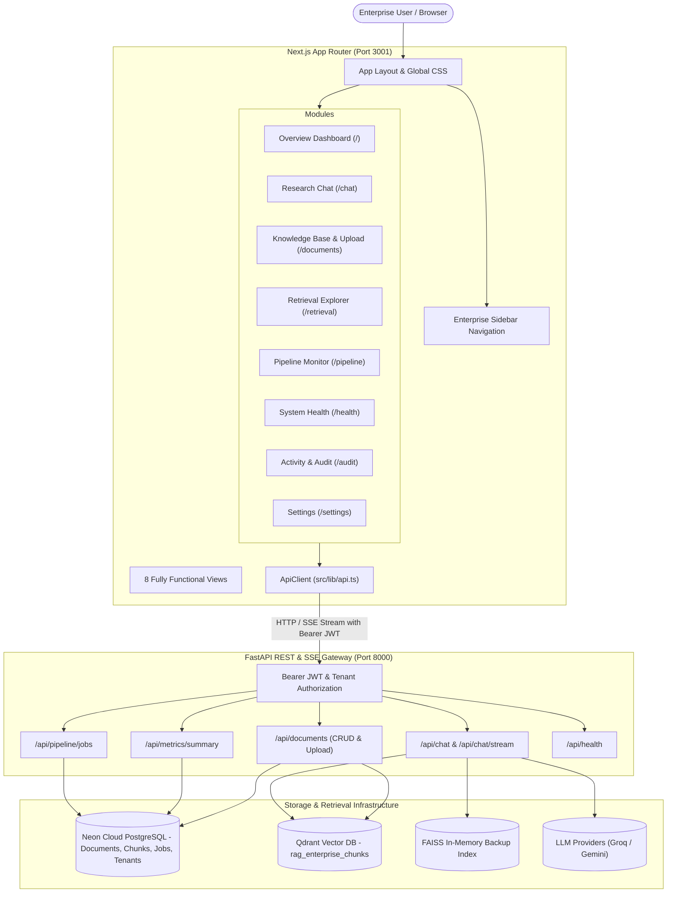

# Next.js Enterprise Multimodal RAG Application Architecture

**Version:** 1.0.0  
**Date:** 2026-11-11  
**Frontend Platform:** Next.js 16 (App Router) + TypeScript + Tailwind CSS  
**Backend Platform:** FastAPI + SQLAlchemy + Neon Cloud PostgreSQL + Qdrant Vector DB  

---

## 1. Architectural Overview



---

## 2. Directory Structure (`frontend/`)

```text
frontend/
├── package.json
├── playwright.config.ts
├── tsconfig.json
├── src/
│   ├── app/
│   │   ├── audit/page.tsx        # Module 7: Activity & Audit
│   │   ├── chat/page.tsx         # Module 2: Research Chat (SSE Streaming & Citations)
│   │   ├── documents/page.tsx    # Module 3: Knowledge Base & Drag-and-Drop Upload
│   │   ├── health/page.tsx       # Module 6: System Health
│   │   ├── pipeline/page.tsx     # Module 5: Pipeline Monitor
│   │   ├── retrieval/page.tsx    # Module 4: Retrieval Explorer (Dense/BM25/RRF/Rerank)
│   │   ├── settings/page.tsx     # Module 8: Settings
│   │   ├── globals.css           # Premium Light Design System CSS tokens
│   │   ├── layout.tsx            # Global Root Layout with Enterprise Sidebar
│   │   └── page.tsx              # Module 1: Overview Dashboard
│   ├── components/
│   │   ├── layout/
│   │   │   └── Sidebar.tsx       # Enterprise navigation shell
│   │   └── ui/
│   │       └── core.tsx          # Card, PageHeader, MetricCard, Badge primitives
│   ├── lib/
│   │   ├── api.ts                # Unified RAG API Client (REST & SSE fetch)
│   │   └── utils.ts              # Formatting & styling utilities
│   └── types/
│       └── index.ts              # TypeScript interfaces for API contracts
└── tests/
    └── app.spec.ts               # Playwright End-to-End browser test suite
```

---

## 3. Communication & Security Contracts
- **Authentication:** HS256 JWT Bearer token stored in browser session storage and transmitted in the `Authorization: Bearer <token>` header.
- **Tenant Isolation:** Enforced on all FastAPI endpoints via `get_authorized_tenant`, validating that the user is an authorized member of `X-Tenant-ID`.
- **Streaming:** Server-Sent Events over `POST /api/chat/stream`, handled via `fetch` ReadableStream and parsed line-by-line into typed JSON payloads (`message_start`, `citations`, `token`, `message_complete`, `error`).
